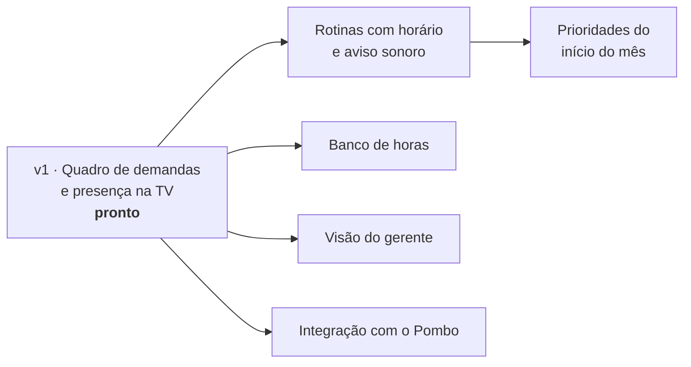

# Roadmap

O Hub é a versão 1 do projeto **API (Analistas da Polybalas Integrados)**.

1. **v1 (pronto):** quadro de demandas (A fazer, Fazendo, Concluído hoje), presença e demanda reservada.
2. **Rotinas com horário e aviso sonoro:** transferência de pedidos às 15h e 17h, com cada pasta marcando a sua e a liberação do relatório de rotas só depois de todas; positivações diárias; comparativo de rotas às terças e quintas. As rotinas viram demandas criadas sozinhas no horário.
3. **Prioridades do início do mês:** meta, fechamentos, novos acompanhamentos por pasta e apuração de campanhas, num quadro que só sai da TV quando tudo estiver feito.
4. **Banco de horas:** planilha base com o saldo de cada um e lançamento manual de entrada e saída do dia anterior. Visível só para a própria pessoa e o gerente, nunca na TV.
5. **Visão do gerente:** tudo de todos, incluindo o banco de horas.
6. **Integração com o [Pombo](https://github.com/fishman2004/pombo):** os envios do dia aparecem na TV, lidos do histórico CSV que o Pombo grava na pasta de rede.
7. **Acesso com PIN**, se a equipe ou a TI pedirem.
